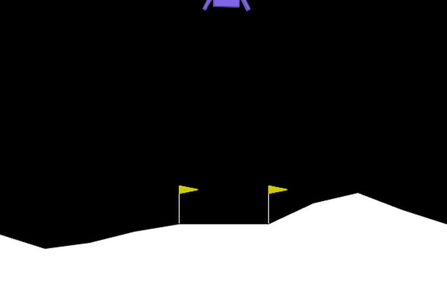
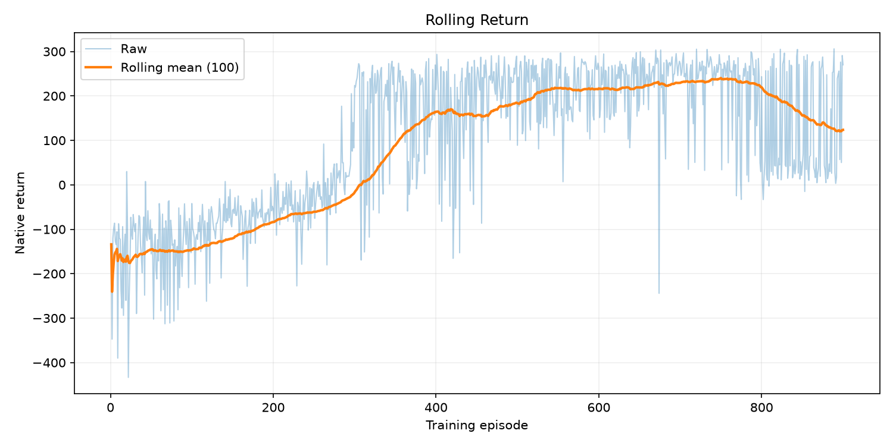
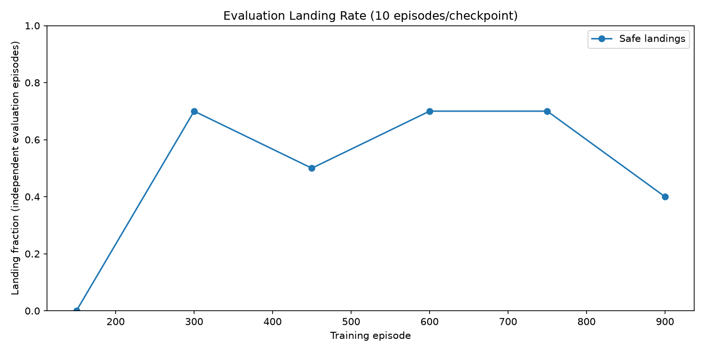
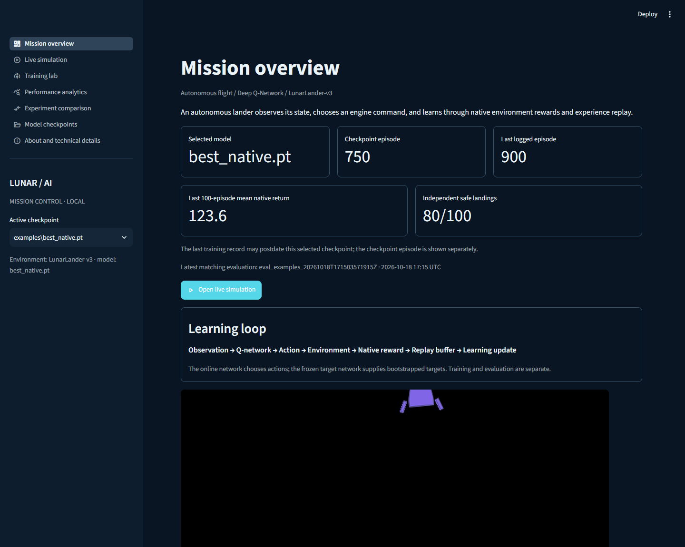
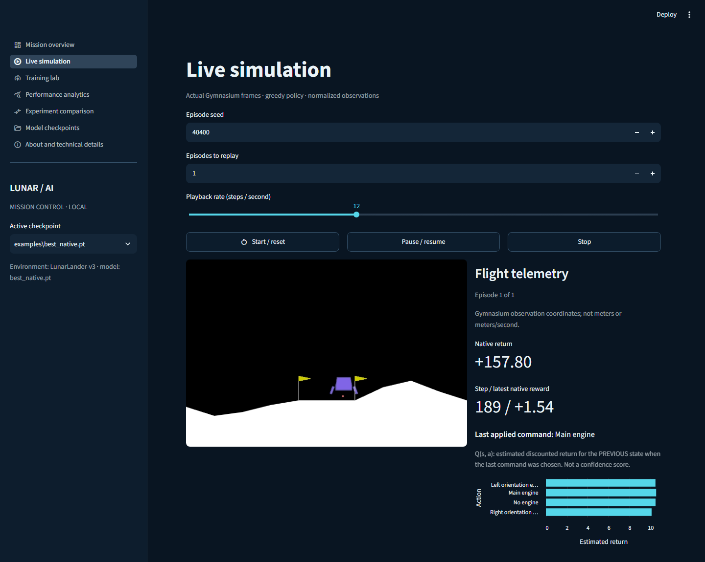
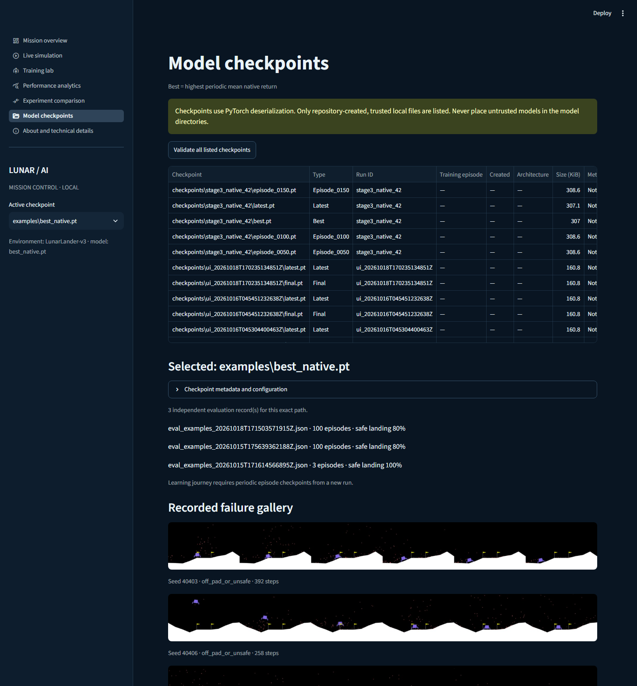

# Lunar AI — Lunar Lander Mission Control

A Deep Q-Network (DQN) agent that learns to land a rocket on a landing pad by
trial and error in Gymnasium's physics-based `LunarLander-v3` simulation.

The agent starts by crashing. It is not given a controller, a trajectory, or a
demonstration. It observes eight numbers describing the lander's position,
velocity, orientation and leg contacts; it picks one of four thruster commands;
and it improves its policy from the rewards and penalties it receives.

---

## Project status

The original DQN CLI is preserved. A local Streamlit mission-control dashboard
adds live Gymnasium rendering, training jobs, interactive analytics, experiment
comparison and checkpoint inspection. Only recorded results are displayed.

The desktop `LUNAR AI.zip` release contains the example model plus three
recorded experiment logs, their best checkpoints, and selected independent
evaluation CSV/JSON artifacts plus a real failure gallery so analytics and
failure inspection work immediately after extraction.
Other generated local runs, including the incomplete Stage 3 study, are not
included. Rebuild a release from this Git
checkout with `python scripts/package_release.py "<destination>.zip"`.

| Phase | Description | Status |
|---|---|---|
| 1 | Environment setup and verification | ✅ Complete — see [`docs/experiments.md`](docs/experiments.md) |
| 2 | Q-network | ✅ Tested |
| 3 | Experience replay buffer | ✅ Tested |
| 4 | DQN agent (epsilon-greedy, Bellman target, target network) | ✅ Tested |
| 5 | Training loop and checkpointing | ✅ Smoke-tested |
| 6 | Training run and honest evaluation | ✅ 900-episode native run; best checkpoint independently evaluated |
| 7 | Optional reward-shaping experiment | ⚠️ Under-trained 300-episode exploratory comparison; no supported shaping conclusion |
| 8 | Training charts and landing playback | ✅ Actual seed-40400 successful landing GIF and PNG charts |
| 9 | Test suite and linting | ✅ Automated tests and Ruff clean |
| 10 | Documentation and publication | 🔄 Documentation and Git commits present; GitHub push pending |
| 11 | Local dashboard and subprocess training | ✅ Tested with real frames and a short worker run |
| 12 | Multi-seed experiment runner | ✅ Reproducible N-seed training with held-out evaluation and statistical aggregation |
| 13 | Statistical analysis & visualization | ✅ Pandas/Plotly analysis with CIs, Wilson intervals, interactive charts |

The original design proposal is in [`docs/BUILD_SPEC.md`](docs/BUILD_SPEC.md);
this README and the actual code are authoritative where implementation differs.

**Measured, held-out result:** Saved native-reward checkpoint from episode 750
of a 900-episode run achieved **80/100 safe pad landings**, mean native return
**252.91** across seeds 40400–40499. Outcomes: **0 crashes**, **4 timeouts**,
**16 rewarded off-pad/unsafe endings**. One training seed; no claim of stable
training across seeds. Full history and the under-trained shaping comparison:
[`docs/experiments.md`](docs/experiments.md).

**Research status (2026-10-24):** The preregistered 900-episode, five-seed paired study
(`scripts/stage3_study.py`, run family `stage3b`) is specified in
[`docs/experiments.md`](docs/experiments.md). A new general-purpose multi-seed runner
(`scripts/multi_seed_experiment.py`) supports configurable seeds, resume, and smoke
testing. Statistical analysis (`src/lunar_lander_ai/analysis.py`) produces confidence
intervals, Wilson score intervals, and interactive Plotly visualizations. **No
multi-seed results table is claimed until all runs and held-out evaluations complete.**







### Measured baseline (Phase 1)

A uniformly random policy, over 30 episodes (`seed 12345`):

| Metric | Random policy |
|---|---|
| **Mean return** | **-182.61** |
| Median return | -125.18 |
| Std return | 125.40 |
| Min / max return | -571.25 / -42.72 |
| Mean episode length | 94.0 of 1000 steps |
| **Landing rate** | **0.0%** (0 of 30) |
| Crash rate | 100.0% |
| Truncation rate | 0.0% |

This **sample** of 30 random episodes had zero landings. Gymnasium registers a
reward threshold of `200`; our configurable early-stop condition is a rolling
mean native return of `200` over 100 training episodes. Neither alone certifies
safe-landing consistency, which is measured separately.

Full detail — including caveats on the small sample size and the left-skewed
return distribution — is in [`docs/experiments.md`](docs/experiments.md).

---

## Problem statement

Landing a rocket is a control problem with discrete actions and
expensive failure. There is no labelled dataset of "correct" thruster commands,
and hand-writing a controller requires solving the dynamics analytically. The
agent must instead discover, from a scalar reward signal alone, a policy that:

- descends toward the pad rather than drifting or ascending,
- arrives with low vertical and horizontal velocity,
- stays near-upright through the descent,
- touches down on both legs without exceeding the impact tolerance.

The environment gives `+100` when the lander comes to rest (even off-pad) and
`-100` on a body crash, with dense guidance for approaching, slowing down and
staying upright. Our safe-landing detector also requires both legs in contact
and normalized horizontal pad offset at most `0.2`.

---

## Why this is not a tutorial

The interesting difficulty is not writing the network. It is that DQN is
unstable on this environment, and most of the engineering effort goes into the
things that make it converge at all:

- keeping **`terminated` and `truncated` separate**, so that hitting the
  1000-step time limit does not teach the agent that the world ends;
- computing the Bellman target under `torch.no_grad()` from a **frozen target
  network** that is never touched by the optimiser;
- **experience replay** that decorrelates consecutive
  samples and stores them in preallocated arrays rather than millions of tuples;
- an **epsilon schedule** that decays slowly enough to keep exploring past the
  first locally-optimal "hover and do nothing" policy;
- **measuring landing success** independently of return, because a lucky high
  score is not a landing.

See [`docs/architecture.md`](docs/architecture.md) for the module map and
[`docs/BUILD_SPEC.md`](docs/BUILD_SPEC.md) for the details.

---

## Requirements

- **Windows 10/11** (developed and verified on Windows; the code itself is
  platform-agnostic apart from the activation commands below).
- **CPython 3.12.** Do not use 3.14 — see the warning below.
- No GPU is required. An NVIDIA GPU is detected and used automatically when
  present (verified here on an RTX 3050 Laptop, 4 GB).

### ⚠️ Use Python 3.12, not 3.14

`pip install "gymnasium[box2d]"` resolves differently per interpreter:

```toml
box2d = ["pygame-ce >=2.1.3",
         "box2d ==2.3.10; python_version < '3.14'",     # prebuilt wheels exist
         "box2d-py ==2.3.8; python_version >= '3.14'",  # source build: needs SWIG + MSVC
         "swig ==4.*; python_version >= '3.14'"]
```

On Python 3.14 that pulls a **source-only** package that must be compiled with
SWIG and the Microsoft C++ build tools. If you don't have a full C++ toolchain
(most people don't), the install fails. On 3.12 it pulls the prebuilt
`Box2D 2.3.10` wheel and just works.

### PyTorch CPU and CUDA wheel selection

PyPI has a Torch 2.14.1 CPython 3.12 Windows wheel. Use the project's pinned
requirements files to choose a **specific CUDA or CPU build** instead of
assuming PyPI's default variant matches your GPU. For CUDA 13.0:

```powershell
python -m pip install torch --index-url https://download.pytorch.org/whl/cu130
```

The PyTorch index listed 2.14.1+cu130 cp312 wheels for Windows x86-64 and
Linux x86-64/aarch64; +cpu wheels for Windows x86-64/ARM64 and Linux x86-64/
aarch64/s390x (checked 2026-10-18). PyPI listed unqualified 2.14.1 cp312
wheels for Windows x86-64, Linux x86-64/aarch64, and macOS ARM64. Wheels for
other combinations were **not** verified. Choose a driver-compatible index;
the cu128 index did not list this exact pinned cp312 version.

---

## Installation

From a terminal in the project root, in **PowerShell**:

```powershell
# 1. Create the virtual environment with Python 3.12 explicitly.
#    Use 'py -3.12' rather than 'py': the py launcher may default to 3.14.
py -3.12 -m venv .venv

# 2. Activate it.
.\.venv\Scripts\Activate.ps1

# 3. Install the pinned dependencies; the file includes the CUDA index.
python -m pip install -r requirements.txt

# 4. For development and tests (also includes runtime requirements):
python -m pip install -r requirements-dev.txt
```

On a machine without an NVIDIA GPU, use
`python -m pip install -r requirements-cpu.txt` **instead** of
`requirements.txt` to avoid downloading the CUDA binaries. The CPU wheel was
verified to exist for Windows/Python 3.12; the project falls back to CPU when
CUDA is unavailable. The CUDA build was exercised on this machine; the CPU-only
wheel has not been installed here.

In **Command Prompt** (`cmd.exe`), step 2 is `.\.venv\Scripts\activate.bat`.
If PowerShell refuses to run the activation script, either run

```powershell
Set-ExecutionPolicy -Scope CurrentUser -ExecutionPolicy RemoteSigned
```

or skip activation entirely and call the interpreter directly:
`.\.venv\Scripts\python.exe -m pip install -r requirements.txt`.

---

## Verifying the setup

```powershell
python scripts/verify_setup.py --episodes 3
```

This prints your interpreter and package versions, the environment's real
observation and action spaces, and the results of three random-action episodes.
It exits non-zero if the environment does not match the shapes this project
requires. Expected tail: `VERIFY SETUP OK`.

To confirm that offscreen rendering works (needed for recording a demo video):

```powershell
python scripts/verify_setup.py --episodes 1 --render rgb_array
```

---

## Usage

### Launch the dashboard

After installing the base dependencies (CPU or CUDA), install the dashboard extra:

```powershell
python -m pip install -e ".[dashboard]"
python -m streamlit run app.py
```

Open the localhost URL printed by Streamlit. The sidebar selects a **trusted local**
checkpoint. Start a seeded episode in **Live simulation** to view real rendered
frames and raw observation telemetry. **Training lab** starts a separate Python
worker; CSV progress is written after each completed episode. Request **Stop**
to finish the current episode and write final checkpoints. **Performance
analytics** charts actual training CSVs and independent evaluation artifacts;
**Experiment comparison** shows configuration differences; **Model checkpoints**
launches a separate greedy evaluation. Downloads are generated from the
displayed CSV files. No network account or API is required.

Architecture: browser → Streamlit UI → existing DQN / Gymnasium / PyTorch;
training and evaluation run in subprocesses → `logs/`, `checkpoints/`, `results/`
→ dashboard charts. See [UI architecture](docs/ui-architecture.md),
[dashboard guide](docs/dashboard-guide.md), and [visual design](docs/visual-design.md).

The animated image above is **recorded model playback**, not the dashboard.
Actual browser capture of the running dashboard:






See [portfolio entry](docs/portfolio.md) for claims backed by measured results.

**Limitations:** the local worker is not a multi-user scheduler. Stop is at an
episode boundary; exact resume is unavailable because replay memory and
environment state are not checkpointed. Dashboard process restarts do not
reattach to a previous worker. A checkpoint is deserialized using PyTorch:
never put untrusted files in the project checkpoint directories. Real-time
playback advances one Gymnasium frame at a time only while the simulation page
is open; leaving the page closes its environment. Rendering speed depends on
hardware and browser refresh timing.
Checkpoints created by the original format store NumPy RNG arrays in the
PyTorch payload and cannot be read with `torch.load(weights_only=True)` on this
Torch version. The UI accepts only project-local checkpoint files (not uploads),
caches checkpoint metadata by **file bytes**, and still requires trusting the
contents of those directories: legacy loading uses pickle and is unsafe for
untrusted files. Worker PID and launch timestamp are persisted; a worker whose
PID is gone after a server restart is shown as stale/orphaned, not live.
The standalone release intentionally omits the `.venv`; install dependencies
on the destination machine. Historical logs without a status record display
"legacy / unknown" rather than an invented completion state.

If Box2D import fails, verify Python 3.12 and the environment with
`python scripts/verify_setup.py`. If Streamlit is missing, install the dashboard
extra above. If evaluation produces no result, inspect `logs/dashboard_evaluation.txt`.


> Run from the project root with the virtual environment activated. Training
> writes a uniquely named folder in `checkpoints/`; substitute its actual path
> below. The full run can take hours and does not guarantee a successful policy.

```powershell
# Quick smoke test — must finish in well under a minute, never launches a real run
python scripts/train.py --episodes 2 --smoke-test

# Full training run
python scripts/train.py --config configs/default.yaml

# Train with command-line overrides
python scripts/train.py --config configs/default.yaml --episodes 500 --seed 7

# Evaluate the included, measured 750-episode checkpoint on 100 independent episodes
python scripts/evaluate.py --checkpoint examples/best_native.pt --episodes 100

# Watch the trained agent actually fly (opens a window)
python scripts/play.py --checkpoint examples/best_native.pt --episodes 5

# Replay one exact evaluation episode
python scripts/play.py --checkpoint examples/best_native.pt --seed 40400

# Save an actual agent episode as a GIF (including failures, no scripted behavior)
python scripts/play.py --checkpoint examples/best_native.pt --episodes 1 --seed 40400 --render-mode rgb_array --save-gif results/demo.gif

# Generate the training charts
python scripts/plot_results.py --log-dir logs

# Verify code quality
python -m pytest
python -m ruff check .
```

### Multi-seed experiments (v0.2.0)

```powershell
# Quick smoke test — 2 episodes per seed, 2 seeds, native + shaped
python scripts/multi_seed_experiment.py --smoke-test --seeds 42 43 --prefix smoketest

# Full multi-seed campaign — 5 seeds, 900 episodes each, native + shaped arms
python scripts/multi_seed_experiment.py --seeds 42 43 44 45 46 --device auto --prefix multiseed

# Resume incomplete campaign (skips completed runs)
python scripts/multi_seed_experiment.py --seeds 42 43 44 45 46 --prefix multiseed

# Analyze results — generates interactive Plotly charts and findings summary
python -m lunar_lander_ai.analysis --results-dir results --log-dir logs --prefix multiseed --output-dir results/analysis
```

The multi-seed runner:
- Trains **independent agents** for each seed (not just evaluating one agent on multiple seeds)
- Evaluates every trained agent on the **same held-out seed range** (40400–40499 by default)
- Reports per-seed metrics and **aggregated statistics with 95% CIs** (t-distribution) and **Wilson score intervals**
- Supports **resume**: skips runs with `status: completed` in metadata; refuses to overwrite incomplete runs
- Saves per-episode and summary CSVs under `results/`; aggregated summary under `results/<prefix>_summary.csv`

The analysis module produces:
- `landing_rate_comparison.html` — per-seed scatter with mean lines
- `landing_rate_ci.html` — grouped bars with 95% CIs
- `return_distribution.html` — violin plots of episodic returns
- `training_curves_native.html` / `training_curves_shaped.html` — mean ±1 std across seeds
- `outcome_comparison.html` — stacked outcome proportions
- `native_vs_shaped_training.html` — native return curves for both arms
- `efficiency_comparison.html` — landing rate vs episode length
- `failure_analysis.html` — box plots by outcome type
- `findings_summary.md` — auto-generated Markdown summary
- `confidence_intervals.csv` — machine-readable aggregated statistics

The committed demo checkpoint (`examples/best_native.pt`, 314,385 bytes) is an (`examples/best_native.pt`, 314,385 bytes) is an
exact copy of `checkpoints/20261015T163534138250Z/best.pt` (SHA256
`cc78469aafbf6fa5f23f72816e89b82bc1735f8abbce80b4a4e1104ea1e74175`).
It was selected by **highest mean native return** at 10-episode periodic
evaluations, not by looking at the 100 held-out episodes. Selecting the best of
several 10-episode evaluations is noisy and can be optimistically biased; the
final checkpoint must also be reported in a controlled comparison. The committed GIF
(`docs/assets/landing_40400.gif`, 1,092,481 bytes, 900x600, 179 frames at 20
fps) was generated with the actual model's actions on seed 40400; it is not a
hand-scripted landing. Every frame comes from the environment's renderer,
captured every second simulated step and upscaled with Lanczos resampling; the
model still acted at every step.

---

## Project structure

```
lunar-lander-ai/
├── configs/                    # YAML experiment configurations
│   ├── default.yaml            # canonical training config
│   └── evaluation.yaml         # evaluation config (distinct seed range)
├── docs/
│   ├── BUILD_SPEC.md           # the implementation contract — start here
│   ├── architecture.md         # module map and data flow
│   ├── reinforcement-learning.md
│   ├── experiments.md          # log of every experiment and its real result
│   └── portfolio.md            # resume write-up and interview notes
├── scripts/                    # thin CLI entry points
│   ├── verify_setup.py         # Phase 1 environment check
│   ├── train.py
│   ├── evaluate.py
│   ├── play.py
│   ├── plot_results.py
│   ├── stage3_study.py         # preregistered paired shaping study
│   ├── multi_seed_experiment.py # reproducible multi-seed runner
│   └── package_release.py      # release ZIP builder
├── src/lunar_lander_ai/        # all real logic lives here
│   ├── config.py               # YAML + CLI -> validated configuration
│   ├── environment.py          # make_env, runtime space verification
│   ├── network.py              # QNetwork
│   ├── replay_buffer.py        # preallocated ring buffer
│   ├── agent.py                # DQNAgent: epsilon-greedy, Bellman target, sync
│   ├── train.py                # episode loop, schedules, checkpointing
│   ├── evaluate.py             # greedy rollouts, no weight updates
│   ├── rewards.py              # optional reward-shaping wrapper
│   ├── metrics.py              # landing detector, summary statistics
│   ├── plotting.py             # training curves (matplotlib)
│   ├── checkpoint.py           # atomic save/load with provenance
│   └── analysis.py             # multi-seed stats & Plotly visualizations
├── tests/                      # pytest suite (37 tests)
│   ├── test_core.py
│   ├── test_dashboard.py
│   ├── test_hud.py
│   ├── test_multiseed.py       # multi-seed unit tests
│   └── test_pipeline.py
├── ui/                         # Streamlit dashboard components
│   ├── data.py, hud.py, jobs.py, playback.py, theme.py
├── data/ logs/ checkpoints/ results/   # generated artifacts (git-ignored)
├── pyproject.toml              # packaging, Ruff and pytest configuration
├── requirements.txt            # pinned runtime dependencies
├── requirements-dev.txt        # pinned development dependencies
├── CHANGELOG.md                # version history
└── LICENSE                     # MIT
```

Generated artifacts under `checkpoints/`, `logs/`, `results/` and `data/` are
ignored. Only the small provenance-documented example checkpoint and portfolio
charts/GIF under `examples/` and `docs/assets/` are committed.

---

## Design decisions worth knowing

**The network predicts action values, not the next state.** `Q(s, a)` is the
expected discounted future return of taking action `a` in state `s`. Choosing
`argmax_a Q(s, a)` gives the control policy directly, with no simulator rollout
at decision time. A dynamics model would predict where the rocket goes and
*still* leave the control problem unsolved.

**Truncation is not termination.** At the 1000-step time limit Gymnasium sets
`truncated=True`, not `terminated=True`. The episode stops, but the value
bootstrap must continue, so the target is
`reward + gamma * (1 - terminated) * max Q_target(s')`. Both flags end the
episode loop; only `terminated` ends bootstrapping. Conflating them teaches the
agent that the universe ends at step 1000.

**Success is measured by landings, not by return.** Mean return can be inflated
by surviving without landing. Evaluation reports landing success rate, crash
rate and truncation rate alongside return, over independent seeded episodes.

---

## Limitations

Documented honestly and as they are found. Currently:

- `LunarLander-v3`'s observation is only *partially* scaled. The position and
  velocity components are normalised by viewport size and frame rate, but the
  angle is raw radians and the angular velocity is only partially rescaled by
  `20/FPS`. That mixed scale is a plausible instability source; adding a running
  mean/std normaliser is a possible later experiment, not part of the baseline.
  The exact formulas are in [`docs/reinforcement-learning.md`](docs/reinforcement-learning.md).
- DQN with a uniformly-sampled replay buffer is sample-inefficient. Expect a
  training run of hundreds to a couple of thousand episodes; the exact figure is
  hardware- and hyperparameter-dependent and is not promised here.
- Seeding makes runs auditable and largely repeatable on one machine. It does
  not guarantee bit-identical results across machines, OSes, or BLAS backends.

---

## License

MIT — see [`LICENSE`](LICENSE). You may use, modify and redistribute this code,
including commercially, provided the copyright notice is retained. There is no
warranty.

## Acknowledgements

Built on [Gymnasium](https://gymnasium.farama.org/) (Farama Foundation),
[Box2D](https://github.com/pybox2d/pybox2d), and
[PyTorch](https://pytorch.org/). The DQN approach follows
Mnih et al., *Human-level control through deep reinforcement learning* (2015).
