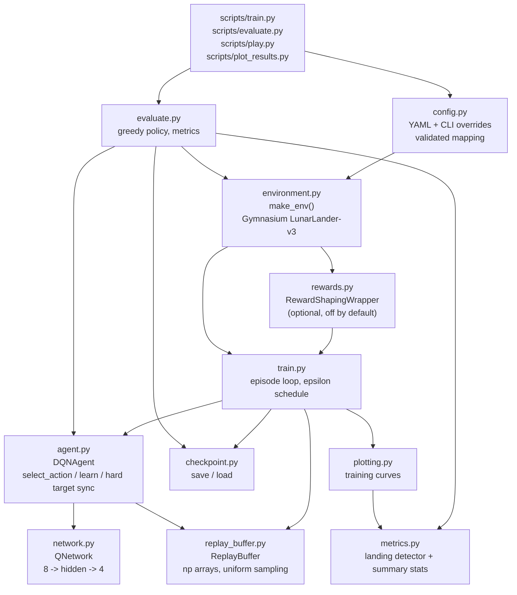

# Architecture

> The local Streamlit application adds `app.py` and `ui/` without changing the
> DQN module ownership below. See [UI architecture](ui-architecture.md) for
> background training, real-frame playback, artifact discovery and the
> standalone dashboard/CLI boundary.

> This page is a conceptual module diagram. `docs/BUILD_SPEC.md` is historical
> planning material; inspect `src/lunar_lander_ai/` for exact signatures.

## System overview



## Module responsibilities

| Module | Owns | Must not |
|---|---|---|
| `config.py` | Loading YAML, dotted-key CLI overrides, validating key hyperparameters. | Touch the environment or torch models. |
| `environment.py` | `make_env(...)`. Creating the Gymnasium env, verifying `observation_space` / `action_space` match the config at runtime, seeding. | Contain any learning logic. |
| `rewards.py` | `RewardShapingWrapper`. Adds a shaping bonus as a separate, logged quantity. | Replace or mutate the native reward. |
| `network.py` | `QNetwork`. Pure function: `(batch, obs_dim) -> (batch, n_actions)`. | Know about replay, epsilon, or the environment. |
| `replay_buffer.py` | Storage + uniform minibatch sampling as torch tensors. | Compute losses or touch the network. |
| `agent.py` | `DQNAgent`: action selection, Bellman target, loss, optimizer step, target sync. | Run episodes or write files. |
| `train.py` | The episode loop, epsilon schedule, logging, checkpoint/eval scheduling. | Contain plotting code or metric definitions. |
| `evaluate.py` | Loading a checkpoint, greedy rollouts, per-episode records. | Update weights for any reason. |
| `metrics.py` | `classify_outcome()`, `summarise()`. The single source of truth for what "landed" / "crashed" / "truncated" mean. | Be duplicated inline in train/evaluate. |
| `checkpoint.py` | Atomic save/load with a version field. Load only trusted local checkpoints. | Decide *which* checkpoint is best. |
| `plotting.py` | Turning a log DataFrame into PNGs. | Require a complete log (must tolerate partial runs). |

Helper logic stays in the modules that use it; there is no `utils.py`.

## Data flow of one training step

```
obs --(epsilon-greedy)--> action --(env.step)--> reward, next_obs, terminated, truncated
                                                        |
                              buffer.add(obs, action, reward, next_obs, terminated, truncated)
                                                        |
                        (every train_frequency steps, if len(buffer) >= learning_starts)
                                                        v
                              sample batch -> Q(s)[a]  vs  r + gamma*(1-terminated)*max Q_target(s')
                                                        |
                                             smooth_l1 loss -> backward -> clip -> step
                                                        |
                                       (every target_update_freq steps) copy online -> target
```

`terminated` and `truncated` are stored as **separate** fields. Collapsing them
is the single most common correctness bug in DQN implementations. See
`docs/BUILD_SPEC.md` section 5.
